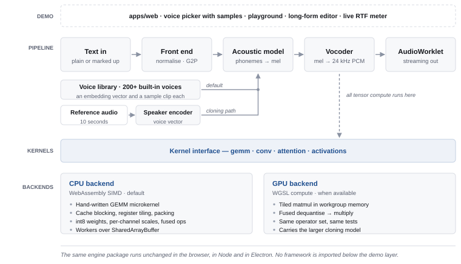

# Cadence

## The fastest high-quality local voice engine

**Author:** Saeed Hussain — Full-Stack Software Engineer, AiroxLab
**Date:** 19 September 2026, revised 24 October 2026
**Status:** Building the MVP — M0 done; M1 built, awaiting reference-machine numbers; M2 (SDK) and M3 (licensing and documentation) done; M4 next
**Roadmap entry:** `PROJECTS-ROADMAP.md` #16
**Languages:** JavaScript (ES2023+) · WebAssembly · WebGPU where supported

---

## 1. Vision

A developer-first text-to-speech engine that generates natural, human-quality speech
directly on the user's device, with no cloud API, no internet connection and no
per-character fee.

**Natural AI voices. Offline. Private. Fast. No API bills.**

Cadence makes high-quality speech generation practical in browsers, desktop
applications, mobile devices and low-powered hardware. The long-term aim is to be the
default infrastructure for any application that needs private, offline, low-cost,
high-quality speech.

---

## 2. The problem

Cloud text-to-speech charges by usage, needs a connection, sends the user's text to
someone else's servers, and adds a network round trip before the first sound. The local
alternatives that exist are hard to integrate, heavy on memory and download size, or
not tuned for the weaker machines most people actually own.

A developer who wants a voice in their app today chooses between a bill that grows
with every user and an integration project. Cadence removes that choice.

---

## 3. The product

An optimised speech engine, an SDK, and a local API for developers adding voice to
their applications.

| # | Feature | What it means | Status |
|---|---|---|---|
| 1 | **Local inference** | Speech is generated on the user's device | Working in the browser |
| 2 | **Low-latency streaming** | Audio plays before the whole text is generated | Working: sentence by sentence |
| 3 | **Hardware optimisation** | CPUs, GPUs, WASM, and WebGPU where supported | WASM measured; WebGPU fails on the fast model (§9) |
| 4 | **Compact models** | Small download, small memory, simple install | 79 MB fast model, 904 voices in one file |
| 5 | **Natural voices** | Intelligibility, pronunciation and expression first | Fast model chosen by listening test; text normalisation not yet built |
| 6 | **Voice customisation** | Consent-based personal voices, with safeguards | Not built — after the MVP (§7) |
| 7 | **Developer SDK** | Simple JavaScript/TypeScript API, then Node, desktop, mobile | Engine API exists inside the repo; not packaged or documented |
| 8 | **Offline operation** | Speech keeps working without a connection | Weights and runtime are cached or self-served; not yet tested with the network off |
| 9 | **Public benchmarks** | Latency, real-time factor, size, memory, quality against alternatives | Speed, size and memory published for 7 candidates on one machine; quality and competitors not yet |

### 3.1 Signature demo

Turn off Wi-Fi on an older laptop, paste a paragraph, and hear natural speech generated
locally with minimal delay.

That claim is validated on defined hardware, not assumed. The reference machine is the
slowest one Cadence must run on: an Intel Core i5-4310U from 2014, 2 cores / 4 threads,
8 GB RAM. For the demo to be true there, three things must hold, and §8 tracks them: the
fast model must be faster than real time *inside the app* (not only in a test harness),
the first sound must arrive in well under a second, and the weights must already be on
the machine.

---

## 4. Competitive advantage

Cadence competes on things that can be measured:

- **Performance on constrained hardware** — measurably better than the alternatives on
  the reference machine, published with the losses included.
- **A simple developer experience** — a voice in a few lines of code, no server to run.
- **Compact, optimised inference** — small downloads, small memory, fast first audio.
- **Reliable cross-platform packaging** — the same engine in a browser, Node and desktop.
- **Strong voice quality at practical resource requirements.**
- **Privacy and offline operation by construction** — there is no server to send text to.

### 4.1 The honest position today

**The primary risk is already visible:** the engine currently runs open models (Piper,
Kokoro) on an open runtime (ONNX Runtime). Anything Cadence does today, a developer could
assemble from the same parts. Local inference alone is not an advantage.

The advantage has to be earned in four places, in this order:

1. **Reliability and integration** — one package that loads, streams, caches, works
   offline and handles failure, instead of a weekend of glue code.
2. **Measured performance on weak hardware** — M0 found where the time goes: in the
   browser, 82% of the fast model's time is convolution, in a shape (few channels, very
   long sequences) the generic runtime handles poorly. That is a concrete, measurable
   opening for specialised kernels — scheduled after the engine is reliable (§7).
3. **Curated voices** — the 904 speakers vary in quality; a tested, named, labelled set
   is work a developer would otherwise have to do.
4. **Public, reproducible benchmarks** — the claim and the means to check it, together.

---

## 5. Target customers

- Application and game developers.
- E-learning platforms.
- Accessibility software developers.
- E-book and reading applications.
- Desktop and mobile application builders.
- Enterprise and embedded-device manufacturers.

---

## 6. Business model

- A free personal tier.
- Paid developer subscriptions.
- Commercial application licences.
- Enterprise and embedded deployment licences.
- Optional paid voice packs or customisation features.

Pricing is validated with real developers before it is fixed. The licensing question that
blocked paid tiers is resolved (§9): Cadence is Apache-2.0 and ships nothing copyleft.

---

## 7. MVP scope

The smallest product that proves the core advantage. Anything outside it waits until
the engine is reliable.

| # | MVP item | Status |
|---|---|---|
| 1 | **One reliable speech model** | Chosen: Piper LibriTTS-R (§10). M1 built; reliable in the app on a second machine, reference numbers pending (§8) |
| 2 | **A working local inference engine** | Working in a Web Worker, streaming, cached |
| 3 | **A browser playground** | Built — wider than the MVP needs (see below) |
| 4 | **A simple JavaScript SDK** | `@cadence/engine` for the browser and Node, typed, documented, with examples |
| 5 | **Streaming audio output** | Working |
| 6 | **Reproducible performance benchmarks** | `npm run bench`, `bench:browser`, `bench:app`, published |
| 7 | **Basic licensing and documentation** | Apache-2.0; NOTICE and third-party notices; GPL resolved by replacing eSpeak NG; getting-started guide |

**Deliberately after the MVP:** voice cloning and personal voices (with consent and
safeguards), specialised kernels, WebGPU, desktop and mobile packaging, more languages,
training Cadence's own weights.

The playground currently also has a long-form studio, a history page, a pitch-matching
stand-in for cloning and a "voice changer" placeholder. They are outside the MVP. They
stay only if they cost nothing in reliability; the cloning stand-in should be hidden or
clearly labelled until real, consent-based customisation exists.

---

## 8. Plan

Milestones are done when their number is measured on the reference machine and
published, not when the code exists.

| Milestone | Done means | Status |
|---|---|---|
| **M0 — Measure and choose** | Real-time factor of every candidate measured on the reference machine; model chosen by the numbers | **Done** 3 Oct 2026 |
| **M1 — Reliable engine** | In the real app, the fast model is within 15% of the standalone browser number; streams with no gaps; works offline after first load; recovers from a failed download | **Built, awaiting reference numbers.** On a Ryzen 5 7430U (6 cores): in-app RTF 0.093, first audio 451 ms, 0 gaps in every run, offline check passing, within 15% of the standalone page. On the i5-4310U it was RTF 2.96 against 0.448 before the fix; `npm run bench:app` and `npm run check:offline` there close it |
| **M2 — SDK** | `@cadence/engine` packaged with a documented API and types; a working example in a few lines; a Node path on the native runtime | **Done** 21 Oct 2026 |
| **M3 — Licensing and documentation** | LICENSE; third-party notices; the phonemiser licence resolved; a getting-started guide | **Done** 24 Oct 2026 — Apache-2.0; eSpeak NG replaced by Cadence's own front end (7.8% phoneme error rate against it) |
| **M4 — Benchmarks against alternatives** | Speed, first audio, size, memory and a defined quality measure, against plain Piper, Kokoro.js, the browser's built-in speech and at least one cloud API, on three hardware tiers | Not started |
| **After the MVP** | Specialised convolution kernels for the measured hot path; WebGPU; consent-based voice customisation; desktop and mobile; Cadence's own weights | — |

---

## 9. Risks

| Risk | Severity | Response |
|---|---|---|
| **Open-source alternatives are already good enough** | **High — the primary risk** | Prove a measured advantage (§4.1) or say so. M4 exists to compare honestly, losses included. |
| **The interface costs more than the model** | High | Measured: on the reference machine the glass interface's animations made generation about 3× slower (RTF 2.96 → 1.02 with motion reduced). Even then the app is 2.3× slower than the standalone page. M1 finds and removes the rest; the interface must get out of the engine's way while it speaks. |
| **The phonemiser's licence** | **Resolved** | eSpeak NG (GPL-3.0) was replaced by Cadence's own front end: CMUdict (BSD 2-clause), word-structure rules and letter-to-sound rules, producing the IPA both models were trained on. eSpeak stays only as a development reference. Remaining risk is quality on unusual words; `npm run g2p:compare` measures it. |
| **One reference machine** | Medium | Every number so far is from one laptop. M4 adds at least two more tiers before any public performance claim. |
| **The fast model does not run on WebGPU** | Medium | Measured: an unsupported integer operation. CPU WebAssembly is the path; WebGPU waits for kernels or a converted model. |
| **First use needs a download** | Medium | The demo's "Wi-Fi off" assumes the weights are present. The SDK must offer bundling or pre-caching, and the docs must say so plainly. |
| **Voice quality is uneven across speakers** | Medium | Curation is real work with a rejection rate: a smaller set of good, named voices beats 904 numbered ones. |
| **Voice customisation misuse** | Medium, later | Consent capture and safeguards are part of the feature, not an afterthought. |

---

## 10. Technical approach

### 10.1 The constraint

**It must be fast on a CPU.** That rules out most of the model space before any code:

| Architecture | Verdict |
|---|---|
| Diffusion / flow matching | Runs the network 16–32 times per utterance. Too slow without a GPU. |
| Autoregressive token models | Latency grows with output length; the models are large. |
| **Non-autoregressive, single pass** | **One forward pass. The only shape that reaches real time on a CPU.** |

### 10.2 The model, chosen by measurement (M0)

Measured on the reference machine; every number in `docs/BENCHMARKS.md`.

- **Default: Piper LibriTTS-R medium.** VITS, about 15M parameters, 904 speakers in one
  79 MB model. Natively RTF 0.132 with first audio at 200 ms; in the browser 0.448 on
  one thread. The best-sounding of the fast candidates in a listening test.
- **Higher quality, opt-in: Kokoro-82M (fp32).** Natively RTF 1.43 on the reference
  machine — slower than real time there, real time on faster hardware.
- **Not chosen:** Piper Lessac low and medium (as fast, one voice each), Piper Lessac
  high (0.91, too close to real time), Kokoro in int8 (2.87, the slowest format measured).

In the browser, one WebAssembly thread was faster than two or four on the two-core
machine. ONNX Runtime's profiler puts 82% of the browser time in convolution — 70%
`Conv`, 12% `ConvTranspose` — almost all of it in the vocoder: 32 to 64 channels over
50,000+ samples, kernels of 3 to 7. That is where specialised kernels would pay.

### 10.3 Voices are speakers, not models

In a multi-speaker model a voice is a speaker index into the same weights. 904 voices
cost one 79 MB download, and adding a voice costs nothing. Every label in the library —
register, gender where the pitch supports one, pace — is measured from the voice itself
(`tools/voices/measure.js`), not guessed.

### 10.4 Architecture

The diagram is the target. Today the engine sits on ONNX Runtime; the boundary that
matters is the **engine interface** — load, stream, preview, cancel — which the app is
written against. `packages/cadence` is plain JavaScript importable from a browser, Node
or Electron; inference runs in Web Workers so the page never blocks. Swapping the
runtime underneath for specialised kernels changes nothing above that interface.

---

## 11. How success is measured

Developers choose Cadence because it delivers a demonstrably better combination of
voice quality, latency, memory efficiency and integration simplicity. Each part is a
number, measured on the reference machine first:

| Metric | Target | Today |
|---|---|---|
| Real-time factor, in the app, browser | < 0.3 | 2.96 (1.02 with motion reduced) |
| Real-time factor, standalone browser | < 0.3 | 0.448 |
| First audio, in the app | < 500 ms | 16.1 s (3.2 s with motion reduced) |
| Fast model download | < 100 MB | 79 MB |
| Peak memory | < 500 MB | 450 MB natively; browser not yet measured |
| Integration | Speech in a few lines of code | No public SDK yet |
| Quality | A defined listening-test score against the alternatives | Not yet defined |

---

## 12. Decisions

### Taken

1. **Default model: Piper LibriTTS-R medium; Kokoro-82M as the opt-in quality path.**
   By measurement, 3 October 2026 (§10.2).
2. **One WebAssembly thread by default** on two-core machines, by measurement.
3. **The runtime files are served by the app**, not a CDN, so it keeps working offline.
4. **The MVP comes before kernels, cloning and new platforms** (9 October 2026).
5. **Licence: Apache-2.0** (24 October 2026) — free adoption, a patent grant, and room for
   paid hosting, support and voice packs on top.
6. **Cadence's own phonemiser replaces eSpeak NG** (24 October 2026), so nothing shipped is
   copyleft.
7. **Weights are served by the app when it can** (21 October 2026): downloaded once to disk at
   build time and served from `/models/`, with the internet as the fallback.
8. **Threads follow the hardware** (21 October 2026): one below eight logical cores, half of
   them above — 2× faster than one thread on a six-core machine.
9. **The interface steps aside while speech generates** (21 October 2026): the ambient
   animation pauses; the player redraws only when what it shows changes.

### Open

1. **Languages at launch** — English only is defensible for the MVP.
2. **Which competitors and which hardware tiers** M4 measures against.
